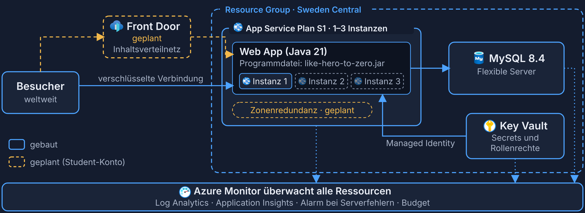

# Architecture

Overview of the Terraform setup. Back to the [Terraform README](https://github.com/Domenic-Puetzer/like-hero-to-zero/blob/master/terraform/README.md).

## Idea

A visitor reaches a Linux web app that runs the Spring Boot JAR (Java 21). The app talks to a MySQL Flexible Server. Database credentials are kept in a Key Vault and read by the app through a Managed Identity. Logs and metrics go to Log Analytics. Optionally, Front Door is the global entry point.

## Building blocks and files

| File | Resources | Page |
|---|---|---|
| `main.tf` | Resource group, random suffix | this page |
| `providers.tf` | Terraform and provider versions, provider settings | this page |
| `app_service.tf` | App Service plan, Linux web app, autoscale setting | [app-service.md](https://github.com/Domenic-Puetzer/like-hero-to-zero/blob/master/docs/terraform/app-service.md) |
| `database.tf` | MySQL server, database, firewall rule | [database.md](https://github.com/Domenic-Puetzer/like-hero-to-zero/blob/master/docs/terraform/database.md) |
| `key_vault.tf` | Key Vault, 2 role assignments, 2 secrets | [key-vault.md](https://github.com/Domenic-Puetzer/like-hero-to-zero/blob/master/docs/terraform/key-vault.md) |
| `monitoring.tf` | Log Analytics, Application Insights, 3 diagnostic settings, action group, metric alert, budget | [monitoring.md](https://github.com/Domenic-Puetzer/like-hero-to-zero/blob/master/docs/terraform/monitoring.md) |
| `front_door.tf` | Profile, endpoint, origin group, origin, route (only with `enable_front_door`) | [front-door.md](https://github.com/Domenic-Puetzer/like-hero-to-zero/blob/master/docs/terraform/front-door.md) |
| `variables.tf` | Input variables | [Terraform README](https://github.com/Domenic-Puetzer/like-hero-to-zero/blob/master/terraform/README.md) |
| `output.tf` | `app_url`, `front_door_url` | – |

Total: 21 resources, 26 with Front Door. The lookup `data.azurerm_client_config` creates nothing and is not counted.

## Resource group and random suffix

The resource group `rg-<project_name>` holds everything. `terraform destroy` deletes it with all contents. It has the tag `project`.

Some names must be globally unique (web app, Key Vault, MySQL server, Front Door endpoint). `random_string.suffix` creates 5 lowercase characters without special characters. The suffix is generated once per build, so a fresh build gets a new one.

## Provider settings

- Terraform `>= 1.5`, `azurerm ~> 4.0`, `random ~> 3.0`. The major versions are pinned, and `.terraform.lock.hcl` fixes the exact versions.
- `prevent_deletion_if_contains_resources = false`: Azure creates some resources itself (for example the "Smart Detection" action group of Application Insights). Terraform does not know them and would refuse to delete the resource group. The flag lets `destroy` remove everything. Trade-off: foreign resources are no longer protected from deletion.

## Resource names

| Resource | Name |
|---|---|
| Resource group | `rg-likeherotozero` |
| App Service plan | `asp-likeherotozero` |
| Web app | `app-likeherotozero-<suffix>` |
| Key Vault | `kv-likeherotozero-<suffix>` |
| MySQL server | `mysql-likeherotozero-<suffix>` |
| Database | `likeherotozero` |
| Log Analytics | `log-likeherotozero` |
| Application Insights | `appi-likeherotozero` |
| Action group | `ag-likeherotozero` |
| Alert | `alert-http-5xx` |
| Budget | `budget-likeherotozero` |
| Autoscale | `autoscale-likeherotozero` |
| Front Door (optional) | `afd-likeherotozero`, `fde-likeherotozero-<suffix>`, `og-likeherotozero`, `origin-webapp`, `route-webapp` |

The prefix is `project_name`. The default is `likeherotozero`.

## Request flow

1. A visitor opens the app URL (`https://...`). The web app has `https_only = true`.
2. The Spring Boot app reads from and writes to the MySQL database over SSL.
3. The app resolves its database credentials from the Key Vault (see [key-vault.md](https://github.com/Domenic-Puetzer/like-hero-to-zero/blob/master/docs/terraform/key-vault.md)).
4. Telemetry goes to Application Insights, logs to Log Analytics.